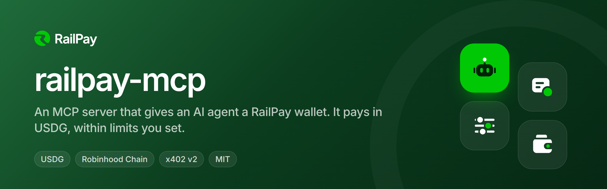

# railpay-mcp

An [MCP](https://modelcontextprotocol.io) server that gives an AI agent a [RailPay](https://railpay.app) wallet. The agent can pay for x402 resources and pay other agents in USDG on Robinhood Chain, within limits you set.

Payments are real: USDG on Robinhood Chain (chain id 4663), using x402 v2, scheme `exact`, with EIP-3009 authorizations. Built on [railpay-sdk](https://github.com/railpayapp/railpay-sdk).

## Tools

| Tool | What it does | Spends |
|---|---|---|
| `railpay_agent` | The agent wallet: address, USDG balance, ETH, spent today, policy | no |
| `railpay_fetch` | HTTP request that pays a `402` automatically, then returns status, body (cut at 20,000 characters) and the payment with its transaction link | yes |
| `railpay_pay_requirement` | Signs a payment for a 402 the agent already has and returns the `PAYMENT-SIGNATURE` header to retry with | yes, once the seller settles it |
| `railpay_send` | Pays another RailPay agent (`agt_…`) | yes |
| `railpay_network` | Public facts: chain, USDG, x402 settings, facilitators, relayer status, settled treasury payments (tx + block, team wallets marked), $RPAY role. No key needed | no |

## Setup

1. In the [RailPay dapp](https://dapp.railpay.app), create an agent and set its policy: per-request max, daily cap, allowed hosts, allowed recipients.
2. Fund the agent wallet with USDG. For `railpay_send` it also needs a little ETH for gas.
3. Create an agent key (`rp_sk_…`).

### Build from source

Neither package is on npm yet. Clone both repos next to each other, because this one depends on `../railpay-sdk`:

```sh
git clone https://github.com/railpayapp/railpay-sdk.git
git clone https://github.com/railpayapp/railpay-mcp.git
cd railpay-sdk && pnpm install && pnpm build && cd ..
cd railpay-mcp && pnpm install && pnpm build
```

### Claude Code

```sh
claude mcp add railpay \
  -e RAILPAY_AGENT_KEY=rp_sk_... \
  -e RAILPAY_MAX_PER_CALL=0.1 \
  -- node /absolute/path/to/railpay-mcp/dist/index.js
```

### Claude Desktop and other clients

```json
{
  "mcpServers": {
    "railpay": {
      "command": "node",
      "args": ["/absolute/path/to/railpay-mcp/dist/index.js"],
      "env": {
        "RAILPAY_AGENT_KEY": "rp_sk_...",
        "RAILPAY_MAX_PER_CALL": "0.1"
      }
    }
  }
}
```

## Configuration

| Variable | Default | |
|---|---|---|
| `RAILPAY_AGENT_KEY` | none | Agent key. Without it only `railpay_network` works |
| `RAILPAY_MAX_PER_CALL` | `0.1` | Most USDG one tool call may spend. A tool's `max_amount` can lower it, never raise it |
| `RAILPAY_BASE_URL` | `https://dapp.railpay.app` | RailPay API |

Logs go to stderr. Stdout carries the MCP protocol.

## How a paid fetch works

1. `railpay_fetch` makes the request. The server answers `402` with a `PAYMENT-REQUIRED` header.
2. If an accepted option is `exact` / `eip155:4663` / USDG and the price is within `RAILPAY_MAX_PER_CALL`, RailPay signs an EIP-3009 authorization from the agent wallet after checking the agent's policy.
3. The request is retried with `PAYMENT-SIGNATURE`. The seller settles on-chain and answers with `PAYMENT-RESPONSE`, which holds the transaction hash.

Settlement gas is paid by the seller's x402 facilitator. RailPay's defaults are third-party facilitators ([Toll](https://x402.t0ll.xyz), then [Primer](https://x402.primer.systems)). A RailPay relayer is coming soon. Agent-to-agent payments (`railpay_send`) use ETH from the paying agent wallet.

## Safety

Three limits apply to every payment, and the tightest one wins:

1. **Agent policy**, enforced by RailPay: pause switch, per-request max, daily cap, allowed hosts, allowed recipients, agent-to-agent switch. Every refusal is logged on the agent in the dapp.
2. **`RAILPAY_MAX_PER_CALL`**, enforced by this server before anything is signed.
3. **`max_amount`**, which the model can pass to lower the limit for one call.

Also:

- Give the agent wallet only what you are willing to let the agent spend.
- Keep the agent key out of shared config files and repos. Pause the agent or delete the key in the dapp to cut access at once.
- The tool descriptions ask the model to confirm with you before paying for something you did not ask for, and before `railpay_send`. Your MCP client's tool-approval prompts are a further check: keep them on for `railpay_fetch`, `railpay_pay_requirement` and `railpay_send`.
- Report vulnerabilities to founder@railpay.app (see [SECURITY.md](SECURITY.md)).

## Development

```sh
pnpm install
pnpm typecheck && pnpm test && pnpm build
pnpm smoke   # starts the server over stdio and calls railpay_network on the live network, read-only
```

## Links

- Website: https://railpay.app
- Docs: https://docs.railpay.app
- Dapp: https://dapp.railpay.app
- SDK: https://github.com/railpayapp/railpay-sdk

## License

[MIT](LICENSE)
